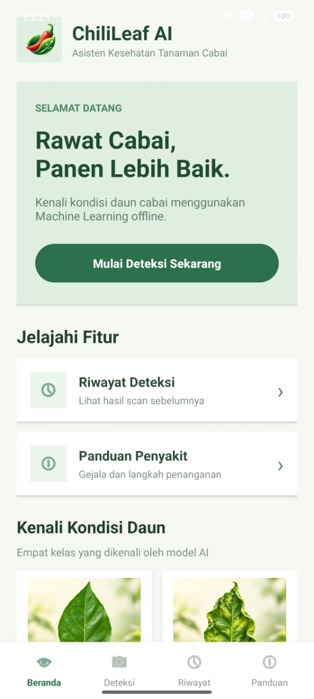
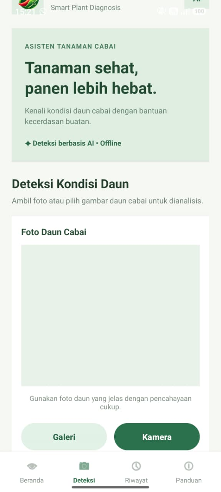
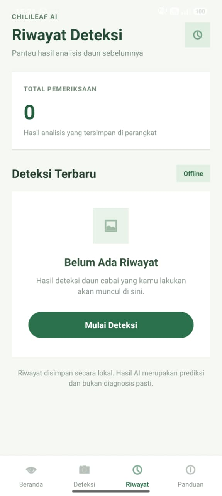
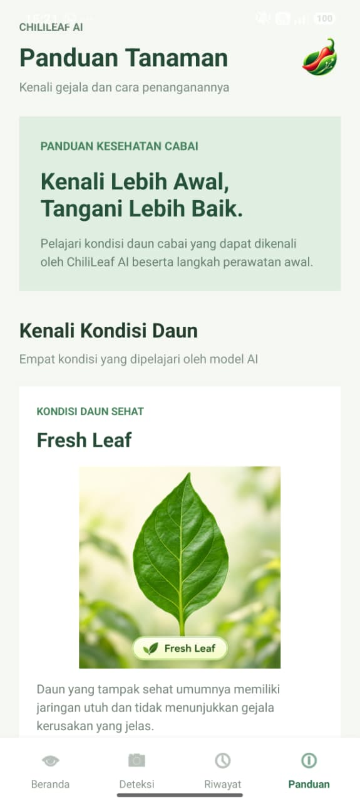

# Chili Leaf Disease Classification — ChiliLeaf AI

Machine Learning-based chili leaf disease classification integrated into a native Android application using Kotlin and LiteRT (TensorFlow Lite).

## Project Overview

ChiliLeaf AI is an Android application that analyzes chili leaf images using an on-device Machine Learning model.

Users can capture photos with the camera or select images from the gallery. The application runs inference offline and displays the predicted leaf condition, confidence score, and initial treatment recommendations.

The application also includes a dashboard, detection history, and a disease information guide.

## Technologies

- Python
- TensorFlow / Keras
- Google Colab
- MobileNetV2
- TensorFlow Lite (.tflite)
- LiteRT for Android
- Kotlin
- Android Studio
- Gradle

## Project Structure

- `ml/notebooks/` — Model training and experiments
- `ml/models/` — Machine Learning model artifacts
- `ml/results/` — Evaluation outputs and visualizations
- `android-app/` — Native Android application
- `android-app/app/src/main/assets/` — Bundled model and class labels
- `docs/` — Project documentation

## Machine Learning Model

| Property | Value |
|---|---|
| Model file | `mobilenetv2_chili_float32.tflite` |
| Model family | MobileNetV2 |
| Deployment format | TensorFlow Lite |
| Tensor data type | Float32 |
| Input image size | 224 × 224 pixels |
| Color format | RGB |
| Number of classes | 4 |
| Model file size | 8,906,396 bytes (approximately 8.49 MiB) |
| Inference runtime | LiteRT |
| Execution backend | CPU |
| Execution mode | Offline |

**Bundled model location:**

`android-app/app/src/main/assets/mobilenetv2_chili_float32.tflite`

**Labels location:**

`android-app/app/src/main/assets/labels.txt`

### Model Identity

SHA-256:

`989F6CE8AF959779C524BA7E85254E6DE957D4145AD51ECE341A3A3FDEA47159`

This checksum identifies the exact model artifact bundled with the Android application.

A formal training-version identifier has not yet been verified. The SHA-256 fingerprint is used to identify the deployed model revision.

### Classification Labels

The Android application maps model outputs to these labels in the following order:

1. Anthracnose
2. Cercospora Leaf Spot
3. Fresh Leaf
4. Leaf Curl Disease

The label ordering is defined in `labels.txt` and must match the class-index ordering used during model training and export.

## Real Model Inference

The Android application uses a real Machine Learning model, not mocked classification results.

The model is loaded in `ChiliLeafClassifier.kt` using LiteRT:

```kotlin
private val model = CompiledModel.create(
    context.assets,
    MODEL_NAME,
    CompiledModel.Options.CPU
)
```

The classifier writes the processed image data to the input buffer, executes the model, and reads its output:

```kotlin
inputBuffers[0].writeFloat(input)

model.run(inputBuffers, outputBuffers)

val probabilities = outputBuffers[0].readFloat()
```

The model output is used to determine the predicted class and confidence displayed in the application.


### Training and Android Compatibility

The Android classifier follows the preprocessing design
used during model training.

Verified from `ml/notebooks/chili_leaf_training.ipynb`:

- Architecture: MobileNetV2.
- Input size: 224 x 224 pixels.
- Input format: RGB Float32.
- Input range: 0-255.
- Normalization: Rescaling(1/127.5, offset=-1)
  is included inside the trained model.
- Aspect ratio: preserved with white padding.
- Output: four-class Softmax classification.

The label order in the Android `labels.txt` matches
the class order defined in the training notebook.

The model was exported using TensorFlow Lite Converter
from the trained Keras model.

The Android implementation uses bitmap interpolation
that may differ slightly from PIL Lanczos interpolation
used during training.

Model loading and real inference are implemented in
`ChiliLeafClassifier.kt`.

The predicted label, confidence, treatment guidance,
and local history are handled by `MainActivity.kt`.

## Core Android Features

### Home

Displays the ChiliLeaf AI dashboard and information about four chili leaf conditions.

### Detection

- Capture a chili leaf image using the camera.
- Select an image from the gallery.
- Perform on-device model inference.
- Display the predicted condition.
- Display model confidence and class scores.
- Show initial treatment recommendations based on the predicted class.

### Detection History

Stores recent detection results locally, including:

- Predicted class
- Confidence score
- Detection timestamp
- Saved scan photo

### Disease Guide

Provides information about the four supported chili leaf conditions and initial plant-care guidance.

## Android Build Instructions

### Requirements

- Android Studio
- Compatible Java Development Kit (JDK)
- Android SDK
- Internet access for initial Gradle dependency downloads

### Build Debug APK

From the repository root, open PowerShell:

```powershell
cd android-app
.\gradlew.bat assembleDebug
```

Ensure the Android SDK is configured through `ANDROID_HOME` or the machine-local `local.properties` file.

Expected output:

```text
BUILD SUCCESSFUL
```

Generated APK:

`android-app/app/build/outputs/apk/debug/app-debug.apk`

Build outputs, local SDK configuration, APK files, and Gradle caches are excluded from Git tracking through `.gitignore`.

## Testing and Verification

The application has been exercised on a physical Samsung Android device.

The following functionality has been tested during development:

- Application launch and navigation
- Camera and gallery image selection
- Offline model inference
- Classification results and confidence display
- Initial treatment recommendations
- Local detection history and scan photos

The Android debug build has also been successfully generated using Gradle.

A separate fresh clone of the repository was built successfully on the development machine after configuring the installed Android SDK.

### Verification Scope

These checks demonstrate that the bundled model executes and that its outputs are consumed by the application's core detection workflow.

Model accuracy, calibration, preprocessing consistency, and class-index alignment require separate verification against the training and evaluation artifacts.

## Development Roadmap

- [x] Initialize GitHub repository
- [x] Create project structure
- [x] Prepare model training resources
- [x] Export a TFLite classification model
- [x] Develop the Android application in Kotlin
- [x] Integrate real model inference into the detection feature
- [x] Test the application on a physical Android device
- [x] Verify debug APK generation
- [x] Audit repository structure and `.gitignore`
- [x] Document the deployed model artifact
- [ ] Complete the documented cross-check of training preprocessing and output label ordering
- [ ] Confirm and document the formal training model version and evaluation metrics

## Limitations

- Predictions are based on input images and may be incorrect.
- Classification results should not be treated as definitive agricultural diagnoses.
- Image quality, lighting, and background conditions can affect results.
- The current model recognizes four predefined classes only.

## Future Development

This project may be expanded into undergraduate thesis research using chili leaf images collected under real agricultural field conditions.

Future work may include more extensive external validation, model optimization, dataset expansion, and improved disease detection performance.

## Application Screenshots

The following screenshots were captured from the ChiliLeaf AI Android application running on a physical Samsung smartphone.

### 1. Home Screen



### 2. Detection and Classification



### 3. Detection History



### 4. Disease Guide




## Dataset and Model Evaluation

ChiliLeaf AI uses a dataset of 1,548 chili leaf images divided into four classes.

### Dataset Distribution

| Class | Images |
|---|---:|
| Anthracnose | 352 |
| Cercospora Leaf Spot | 372 |
| Fresh Leaf | 440 |
| Leaf Curl Disease | 384 |
| **Total** | **1,548** |

### Dataset Split

| Split | Images |
|---|---:|
| Training | 1,136 |
| Validation | 207 |
| Testing | 205 |
| **Total** | **1,548** |

Dataset split source:
`ml/results/dataset_split_manifest_v2.csv`

### Model Evaluation Results

The MobileNetV2 model was evaluated on 205 test images.

| Metric | Result |
|---|---|
| Test Accuracy | 94.15% |
| Test Loss | 0.1676 |
| Macro Precision | 95.04% |
| Macro Recall | 92.72% |
| Macro F1-score | 93.22% |
| Weighted F1-score | 94.01% |

### Per-Class Performance

| Class | Precision | Recall | F1-score |
|---|---:|---:|---:|
| Anthracnose | 1.0000 | 0.7436 | 0.8529 |
| Cercospora Leaf Spot | 0.8333 | 1.0000 | 0.9091 |
| Fresh Leaf | 0.9683 | 0.9839 | 0.9760 |
| Leaf Curl Disease | 1.0000 | 0.9815 | 0.9907 |

Evaluation artifacts:

- `ml/results/classification_report.txt`
- `ml/results/confusion_matrix.png`
- `ml/results/prediction_errors.csv`
- `ml/results/prediction_errors.png`

The reported test accuracy does not guarantee the same
performance on new images captured in real agricultural
conditions.

## Running the Android Application

### Requirements

- Android Studio
- Android SDK
- Compatible JDK
- Android smartphone or emulator
- USB debugging enabled when using a physical smartphone

### Build and Run

1. Clone this repository.
2. Open the `android-app` folder in Android Studio.
3. Wait for Gradle synchronization to finish.
4. Configure the Android SDK if necessary.
5. Connect an Android device or start an emulator.
6. Select the target device.
7. Click **Run** to install and launch ChiliLeaf AI.

Alternatively, build the debug APK from PowerShell:

```powershell
cd android-app
.\gradlew.bat assembleDebug
```

Generated APK:

`android-app/app/build/outputs/apk/debug/app-debug.apk`

Internet access may be necessary for the initial dependency
download. Once installed, the bundled ML classification
workflow operates offline.

## Demo Scenario - 17 October 2026

**Project:** ChiliLeaf AI
**Date:** Saturday, 17 October 2026
**Time:** 13:00 WITA
**Device:** Physical Android smartphone

### 1. Introduction

Introduce ChiliLeaf AI as a native Android application
for chili leaf disease classification.

Explain that the application uses MobileNetV2 and
LiteRT for offline Machine Learning inference.

### 2. Home Screen

Open the application and introduce the dashboard
and four supported classes.

### 3. Detection Feature

Navigate to the Detection screen.

Select a chili leaf image from the gallery or capture
a photo using the smartphone camera.

### 4. Machine Learning Inference

Demonstrate the loading indicator while the image
is processed by the bundled model.

### 5. Classification Result

Explain the displayed:

- Predicted disease or leaf condition
- Confidence score
- Class probabilities
- Initial treatment recommendations

### 6. Detection History

Navigate to History.

Show the saved classification result,
confidence score, timestamp, and scanned photo.

### 7. Disease Guide

Open the Guide screen and explain the available
information about supported chili leaf conditions.

### 8. Offline Demonstration

Enable Airplane Mode.

Select a locally stored image and perform detection
to demonstrate offline inference.

### 9. Error Handling

Open the gallery and cancel image selection.

Repeat using the camera.

Show that the application remains open and displays
cancellation feedback.

### 10. Closing

Summarize the results:

- Dataset: 1,548 images
- Model: MobileNetV2
- Test accuracy: 94.15%
- Test images: 205
- Android inference: Offline using LiteRT

Explain that predictions are not definitive
agricultural diagnoses.